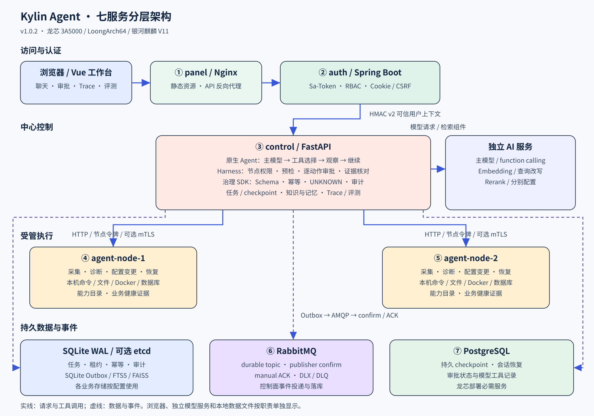
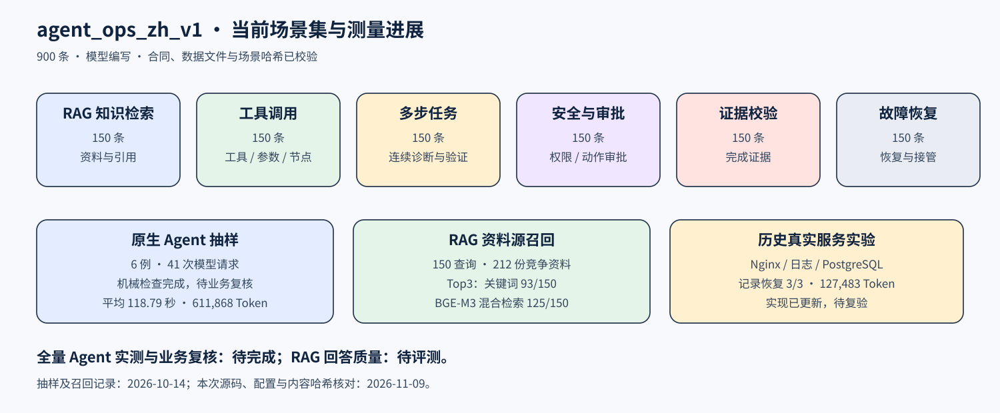

# Kylin Agent · 面向信创服务器的智能运维平台

> 第十五届“中国软件杯”A2 赛道 · 全国三等奖
> 龙芯 3A5000 · LoongArch64 · 银河麒麟高级服务器 V11

Kylin Agent 将自然语言请求转成可审批、可审计、可回放的运维任务。主模型自主选择工具和处理顺序，中心控制面管理权限、预检与逐动作审批，受管节点采集事实、执行操作并返回证据。

本仓库公开架构图、功能说明、开发取舍、演示流程与脱敏测量摘要。项目作为毕业设计继续迭代，源码、完整数据集和部署资产暂不发布。

## 当前进展

主项目 **v1.0.2**，核对提交 `a0ec2e9`（2026-10-17）；展示内容更新于 **2026-11-09**。

| 进展 | 当前实现 |
| --- | --- |
| 原生 Agent 循环 | 请求直接进入主模型，通过 function calling 选择工具、读取观察并继续处理；大目录按需发现和加载工具 |
| 长任务交互 | 运行中补充引导、排队发送、暂停提问、回答后恢复原会话；审批后继续验证 |
| 运维处置 | 配置差异预览与应用、数据库会话诊断与恢复、备份恢复与回退、多节点分批变更、业务健康验证 |
| 平台与飞书 | 自动采样、告警防抖、通知和恢复跟踪；操作人员点击生成方案后调用 Agent，变更逐动作审批 |
| Trace 工作台 | 业务流程与组件调用两级视图，展示阶段、模型用量、工具观察和 Harness 结论 |
| 经验与记忆 | 处置验证后生成待审经验，审核发布后参与检索；定期归纳、限量核心记忆、事实时效与冲突管理 |
| 评测中心 | 默认展示 `agent_ops_zh_v1`：六个维度各 150 条，共 900 条；按数据与场景哈希关联测量记录 |

## 分层架构



生产交付面向 `linux/loong64`，采用 **panel + auth + control + 两个 agent + RabbitMQ + PostgreSQL** 七服务 Compose。浏览器访问面板，PostgreSQL 保存 checkpoint，SQLite / etcd 按配置提供其他状态功能。

| 层次 | 组件 | 职责 |
| --- | --- | --- |
| 访问层 | Vue 面板 / Nginx | 聊天、巡检、告警、文件、数据库、审批、审计与评测 |
| 认证层 | Spring Boot / Sa-Token | 账号、角色、节点权限、Cookie / CSRF、HMAC v2 可信签名 |
| 控制层 | FastAPI / 原生 Agent / Harness | 模型会话、工具发现、任务状态、预检、审批、证据核对 |
| 执行层 | 受管 Agent 节点 | 节点令牌认证、采集、诊断、变更和健康验证，可配置 mTLS |
| 数据层 | PostgreSQL / SQLite WAL / etcd / RabbitMQ | checkpoint、状态、租约、幂等、Outbox、可靠消息、审计和回放 |
| AI 与知识 | 独立模型服务 / Docling / FAISS | 主模型、Embedding、查询改写、Rerank、结构解析与检索 |

网关到控制面使用 HMAC v2；控制面到节点使用 HTTP 与节点令牌；事件先写 SQLite Outbox，再经 RabbitMQ 确认投递。详细连接关系见 [架构说明](docs/architecture.md)。

## 一次任务如何推进

```text
运维请求 → 身份与节点权限 → 主模型选择工具 → 受管节点返回观察
                              ↑                     │
                              └──── 继续研判 ────────┘
需要信息：提问 → 操作人员回答 → 恢复会话
需要变更：预检 → 逐动作审批 → 执行 → 业务验证
任务结束：证据核对 → Trace / 审计 → 待审经验
```

工具目录超过 12 个时，先提供分类和用途，由模型调用 `discover_tools` 发现工具并加载完整参数声明。模型可跨分类继续查询；Harness 在执行前校验 Schema、角色、节点范围、命令、路径及审批。

Token、活动时间和轮数持续记录。重复错误或相同观察触发调整提示，持续停滞后保留证据并结束自动重试。提问和审批保存 checkpoint，回答或批准后回到同一会话继续处理。

## 技术栈

| 模块 | 技术 | 在项目中的用途 |
| --- | --- | --- |
| 前端工作台 | Vue 3、Vite、Mermaid、Marked、DOMPurify | 交互面板、静态资源构建、流程图与 Markdown 展示 |
| 认证服务 | Java 17、Spring Boot 3.5.16、Sa-Token 1.45.0 | 用户会话、RBAC、可信网关与身份核验 |
| 控制面与节点 | Python ≥3.10、FastAPI、Uvicorn、HTTPX | API、流式响应、节点通信和运维工具 |
| Agent 与恢复 | 原生 function-calling 循环、LangGraph 0.2.76、PostgreSQL / SQLite checkpoint | 模型/工具循环、审批恢复与兼容工作流 |
| 执行治理 | Agent Runtime Governance SDK v0.9.1 | Schema、审批、持久幂等、UNKNOWN 和 JSONL 审计 |
| 知识与文档 | SQLite FTS5 / BM25、FAISS / NumPy、Docling、ONNX、RapidOCR | 关键词/混合检索、结构切块、版面识别与 OCR |
| 消息与观测 | RabbitMQ / Pika、OpenTelemetry OTLP/HTTP | 可靠事件投递与脱敏 Trace 导出 |
| 工程交付 | Docker Compose、GitHub Actions、pytest、Spring 测试、浏览器 smoke | 七服务编排、构建、功能回归和验收 |

详见 [技术栈与组件职责](docs/technology-stack.md)。SDK 依赖固定到提交 `4cfb9ccc`，Kylin Adapter 绑定业务工具、节点身份与公开结果。

## 实测记录

| 测量范围 | 已记录结果 | 当前状态 |
| --- | --- | --- |
| 900 条场景集 | 六维度各 150 条，模型编写，合同与内容哈希已校验 | 数据就绪，全量 Agent 实测待完成 |
| 6 个原生 Agent 抽样 | 真实模型 + 隔离模拟工具；41 次模型请求，平均 118.79 秒，已报告 611,868 Token | 机械检查完成，6 例待业务复核 |
| 150 条 RAG 查询 | 212 份竞争资料；关键词资料源 Top3 为 93/150，BGE-M3 混合检索为 125/150 | 资料源召回已测量，回答质量待评测 |
| 3 个真实服务故障样例 | 历史记录：Nginx、日志、PostgreSQL 均恢复，127,483 Token | 实现已更新，待复验 |
| 本次功能回归 | 原生循环、监控、飞书、Trace、评测、处置和记忆：250 passed、7 subtests passed | 2026-11-09 本地检查通过 |

6 例抽样记录来自 2026-10-14 的运行及定向复测。工具耗时取自夹具派发，用量缺失 1 次，费用为 `null`。包含首次多步失败的全部 7 次尝试另存为 53 次模型请求、已报告 804,351 Token。当前运行策略使用用量观测与停滞控制。

详细来源见 [评测说明](docs/evaluation.md)、[当前状态](evaluation/current-status.json) 与 [测量摘要](evaluation/agent-ops-measurements-2026-10-14.json)。旧版成绩归档于 [历史记录](evaluation/history/README.md)。



## 开发过程中的主要取舍

| 演进 | 选择 | Git 记录 |
| --- | --- | --- |
| 多协议任务生命周期 | REST / A2A 共用请求指纹、租约、取消和结果复用 | `f59e046` |
| 流式并发 | 固定 worker 池与有界队列，终态可靠缓存，中间事件可合并 | `7a56252` |
| 运行时治理 | 通用审批、幂等与审计交给独立 SDK，业务语义由 Adapter 绑定 | `2dc44cd` |
| Agent 编排 | 从 IntentGraph + 规划流程演进到主模型原生工具循环，保留按需工具发现 | `dd066a1` → `84e8040` |
| 评测与知识 | 新场景集、测量分项、待审经验与时效事实统一接入工作台 | `84e8040` |
| 告警处置 | 自动采样与通知，操作人员主动生成方案，逐动作审批 | `a0ec2e9` |

每项的动机、实现成本及提交关系见 [Git 历史中的开发取舍](docs/development-decisions.md)。

## 阅读与演示

| 内容 | 入口 |
| --- | --- |
| 系统连接与原生循环 | [架构](docs/architecture.md) · [技术栈](docs/technology-stack.md) |
| 权限、预检与逐动作审批 | [安全与审批](docs/security-layers.md) |
| 变更、恢复与经验整理 | [运维闭环](docs/operations.md) · [知识与记忆](docs/rag-knowledge.md) |
| 告警和卡片处置 | [告警与飞书](docs/alerts-feishu.md) |
| 业务与组件回放、消息恢复 | [Trace](docs/trace-replay.md) · [可靠性](docs/reliability.md) |
| 龙芯与麒麟适配 | [平台适配](docs/loongarch-adaptation.md) |
| 七分钟演示 | [演示脚本](docs/demo.md) |

项目中的审批一致性、副作用幂等、未知结果对账与证据链机制，已抽象为独立的 [Agent Runtime Governance SDK](https://github.com/Success6666/agent-runtime-governance)。
