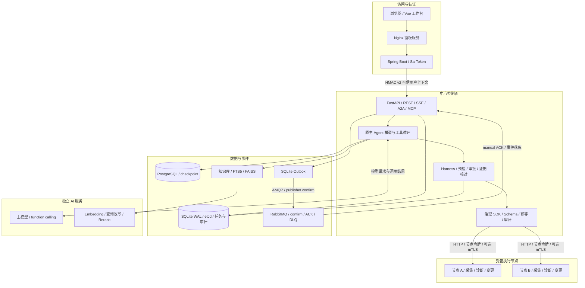

# 系统架构与原生工具循环

Kylin Agent v1.0.2 采用中心控制面与受管节点架构。控制面管理模型会话、任务、审批与证据，节点执行本机采集和操作。七个 Compose 服务为 `panel + auth + control + agent-a + agent-b + RabbitMQ + PostgreSQL`。

## 组件连接

浏览器访问面板和认证网关；网关提供角色与节点身份，节点接口核对独立令牌。工具执行走节点 HTTP，RabbitMQ 负责控制面的可靠事件链路。龙芯部署的 PostgreSQL 专门保存 checkpoint，SQLite / etcd 按配置承担任务和状态功能，Outbox 与知识库使用各自持久存储。

## 模型与工具循环

请求和会话历史直接进入 `FunctionCallingAgentLoop`。模型选择工具，Harness 校验调用，节点返回 ToolMessage 观察，模型继续诊断、检索、提问或回答。

工具目录超过 12 个时，先提供业务分类、中文用途和数量。模型通过 `discover_tools` 发现并加载完整声明，上下文最多保留 12 个完整工具声明，可跨分类继续查询。工具选择、已加载声明与字节数进入 Trace，Token 取自模型回执。

`AgentGraphRuntime` 提供 Harness：节点绑定、权限、Schema、命令、路径、预检、审批和完成证据核对。写调用先形成参数与节点绑定的提案，批准后复用冻结动作执行，再把真实结果送回原会话。`Plan` 保存已发生的工具选择与待批动作。

## 提问、引导与恢复

| 交互 | 运行行为 |
| --- | --- |
| 提问 | `request_user_input` 保存 checkpoint 并进入 `waiting_input`，原操作者回答后恢复 |
| 运行中引导 | 在模型调用间消费补充信息，尚未执行的工具选择按新引导重新处理 |
| 排队消息 | 当前任务结束后按顺序派发，等待提问或审批时暂停，可取消 |
| 审批恢复 | checkpoint 保存消息、调用 ID 与用量，恢复时核对当前权限和动作版本 |
| 完成核对 | 缺失证据反馈给模型继续处理，信息缺口进入提问，持续阻塞标为未完成 |

Token、活动时间和轮数持续观测。相同观察或相同错误先触发调整提示，持续停滞后停止自动重试。主模型配置缺失或显式关闭原生调用时使用规则模式。

LangGraph 管理已有状态、checkpoint 与兼容工作流；原生循环由模型根据观察选择下一步，Harness 校验每次实际操作。详细技术分工见 [技术栈](technology-stack.md)。

## 请求、执行与消息

`ChatExecutionService` 统一 REST / A2A / SSE 生命周期，请求指纹、owner token、租约与幂等账本关联同一请求。事件先写入 SQLite Outbox，再经 RabbitMQ 确认投递；消费完成后手动 ACK，错误消息进入 DLQ。

同步池默认 8 workers / 32 queue，SSE 池默认 64 workers / 512 queue，均可配置。任务、审批、调用和回放通过 Trace 关联。

图示源文件：[architecture.mmd](../diagrams/architecture.mmd)。相关内容：[安全与审批](security-layers.md) · [可靠性](reliability.md) · [Trace](trace-replay.md)。
