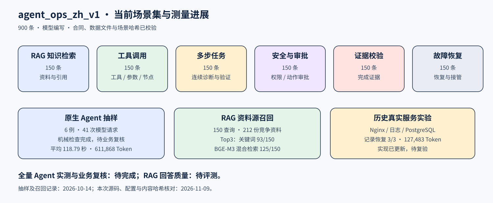

# 评测数据与实测进展

v1.0.2 评测中心默认展示 `agent_ops_zh_v1`，分别显示场景总量、已测样例、待业务复核项、延迟、提供商用量和 RAG 资料源召回。报告通过数据文件 SHA-256 与逐条场景哈希关联当前数据。

## 当前场景集

| 维度 | 条数 |
| --- | ---: |
| RAG 知识检索 | 150 |
| 工具调用 | 150 |
| 多步任务 | 150 |
| 安全与审批 | 150 |
| 证据校验 | 150 |
| 故障恢复 | 150 |
| 合计 | 900 |

正文由 `deepseek-v4.1-flash` 编写，观测使用隔离测试夹具。合同、计数和哈希已校验，人工金标审核待开展。BGE-M3 对机制与目标进行两两重复检测，0.88 阈值下最终候选对为 0。

## 原生 Agent 抽样

2026-10-14 的运行及定向复测保存了 6 个当前场景，每维度 1 例。运行使用真实模型与隔离模拟工具，写调用进入审批状态。

| 测量项 | 记录值 |
| --- | ---: |
| 样例数 / 待业务复核 | 6 / 6 |
| 机械工具与终止条件检查 | 6 例完成 |
| 平均 / P50 / P95 / P99 | 118.79 / 118.85 / 228.59 / 239.39 秒 |
| 模型请求 / 失败 / 重试 | 41 / 3 / 3 |
| 已报告输入 / 输出 Token | 588,285 / 23,583 |
| 已报告总 Token / 缓存输入 | 611,868 / 449,152 |
| 用量缺失请求 / 费用 | 1 / `null` |

首次多步样例暴露夹具合同问题，修正后复测受影响样例。包含首次失败的全部记录共 7 次场景尝试、53 次模型请求、已报告 804,351 Token。正文生成用量独立保存，工具耗时记录夹具派发，各次运行并发数分别保存。

运行当时采用原有 12 轮配置；最新原生循环采用 Token、时间和轮数观测及停滞控制。900 条全量原生执行、完整多消息交互测量与业务语义复核待完成。

## RAG 资料源召回

150 条查询在 212 份竞争资料中检索，两种模式均使用项目实际解析、切片、入库、索引与搜索。

| 指标 | 关键词 | BGE-M3 混合检索 |
| --- | ---: | ---: |
| 场景资料源 Top1 | 50/150 | 86/150 |
| 场景资料源 Top3 | 93/150 | 125/150 |
| 最长主资料源 Top3 | 85/150 | 117/150 |
| 检索 P50 / P95 | 108.58 / 151.35 ms | 160.68 / 230.89 ms |
| 全部资料入库 | 3.35 秒 | 7.88 秒 |

评测标签为对应场景资料源，最长主资料源按文档长度选择。回答正确性与人工相关性评测待开展。BGE-M3 已报告 59,875 输入 Token，内部重试逐请求用量待补测，费用为 `null`。

## 真实服务故障记录

历史故障实验使用真实模型和可销毁的 Nginx、日志、PostgreSQL 服务，3 例均记录恢复，错误变更 0，人工接管 0。实验审批为 `synthetic_fixture_only`，业务状态由独立检查确认。平均耗时 84.55 秒，21 次模型请求，已报告 127,483 Token。

2026-11-09 核对发现 `agent_loop.py` 和 `curated_runtime.py` 已更新，其余 7 份实现哈希匹配。该报告现标为历史实测、待复验，见 [故障记录摘要](../evaluation/fault-lab-history-summary.json)。

## 本次验证与历史归档

2026-11-09 在主项目 `a0ec2e9` 执行八组功能回归：原生循环、监控、飞书、Trace、场景集、评测视图、运维闭环和记忆治理，结果 **250 passed、7 subtests passed**。

旧 `evidence_governed_aiops_zh_v1` 数据与成绩通过历史入口查看，加载量为 4,380 行，包含模板枚举、配对轨迹、工具投影和故障规格。v0.6.169、v0.6.203 结果与 v0.6.280 工程记录归档于 [历史记录](../evaluation/history/README.md)。

公开文件：[当前状态](../evaluation/current-status.json) · [Agent 与 RAG 测量摘要](../evaluation/agent-ops-measurements-2026-10-14.json)。

