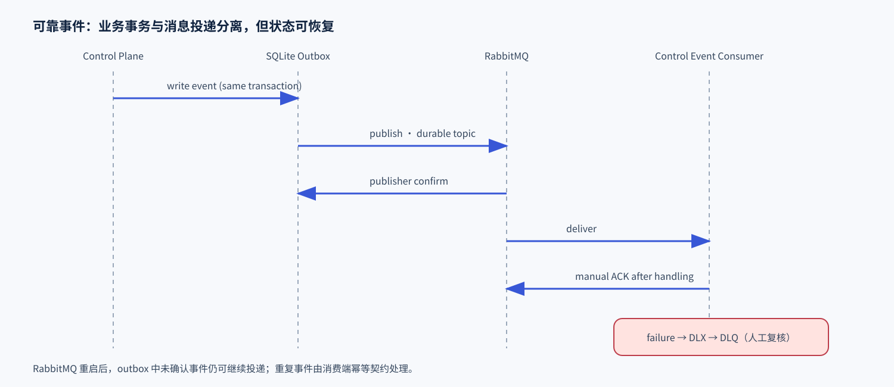

# 可靠消息、幂等与故障恢复

系统分别记录消息投递、副作用执行与结果确认。SQLite Outbox 保存待投递事件，RabbitMQ 管理持久消息、确认和死信，执行账本保存请求身份、租约与操作结果。

## 任务状态

```text
接收请求 → 模型与工具循环 → 提问 / 审批 / 执行 → 业务验证
                         ↓                  ↓
                   checkpoint 恢复     完成 / 未完成 / UNKNOWN / 取消
```

## 关键机制

| 机制 | 实现 |
| --- | --- |
| Outbox | 事件事务性写入 SQLite，恢复任务补发未确认记录 |
| RabbitMQ | durable topic、publisher confirm、manual ACK、DLX / DLQ |
| 请求幂等 | `client_request_id + canonical fingerprint` 关联同一任务 |
| 执行所有权 | owner token、TTL 租约、心跳、过期接管与结果复用 |
| UNKNOWN | 副作用后的回执缺失进入证据核对，保留执行记录 |
| SSE | 普通事件可合并，终态、审批、错误与取消可靠缓存；按游标补读 |

Outbox 发布后收到 broker confirm 才标记已发送。控制面事件消费者完成持久处理后 ACK，毒消息进入 DLQ。工具执行通过节点 HTTP 派发，消息链路负责事件持久投递。



当前同步池默认 8 workers / 32 queue，SSE 池默认 64 workers / 512 queue，容量耗尽显式返回状态。调用输出分块读取并记录 `truncated`，文件下载支持 Range 与客户端取消。
