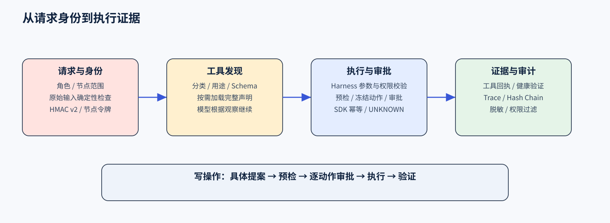

# 安全校验与逐动作审批

主模型选择处理顺序，Harness 和治理 SDK 管理执行资格。身份、工具、参数、节点、预检、审批与结果均关联到同一任务。

## 请求与身份

Spring Boot 网关使用 Sa-Token、RBAC、HttpOnly Cookie 与 CSRF 校验，向控制面发送 HMAC v2 可信签名。受管节点使用独立节点令牌，可配置 mTLS。前端接收公开状态，凭据由服务端维护。

原始用户输入在入口执行一次确定性检查，完整匹配明确的灾难性请求或可解析命令。普通清理、删除说明和模糊变更进入主模型处理，实际调用继续进行参数、路径、命令及审批校验。

## 工具与参数

运行时注册表提供名称、中文用途、分类、别名、Schema、风险等级、只读属性和所需能力。模型按需发现并加载当前可用工具，每次调用核对工具、参数、角色与节点范围，失败观察送回会话供模型修正。

路径解析后核对允许目录，命令核对 allowlist 和 shell 元字符，容器标识及数据库对象使用受控格式。调用输出采用分块读取和有界缓存，响应记录截断状态。

## 变更审批

写操作先生成具体工具、完整参数、目标节点和风险说明，预检后逐动作审批。审批绑定动作版本、确认信息及幂等 `action_id`。恢复时重新检查角色和节点权限，后续新增动作单独审批。

平台与飞书共用审批记录和 Harness。提问回答补全任务信息，操作授权由审批步骤记录。执行回执缺失时保存 UNKNOWN 状态，进入证据核对流程。

## 治理与审计

`agent-runtime-governance` v0.9.1 管理 Schema、审批、持久幂等、UNKNOWN 与 JSONL 审计。Kylin Adapter 绑定业务工具、节点身份与结果。原治理实现作为显式 legacy fallback 保留。

Trace、工具回执、审批身份、任务和审计 hash chain 联合记录过程。公开结果脱敏，回放按操作者权限过滤。

